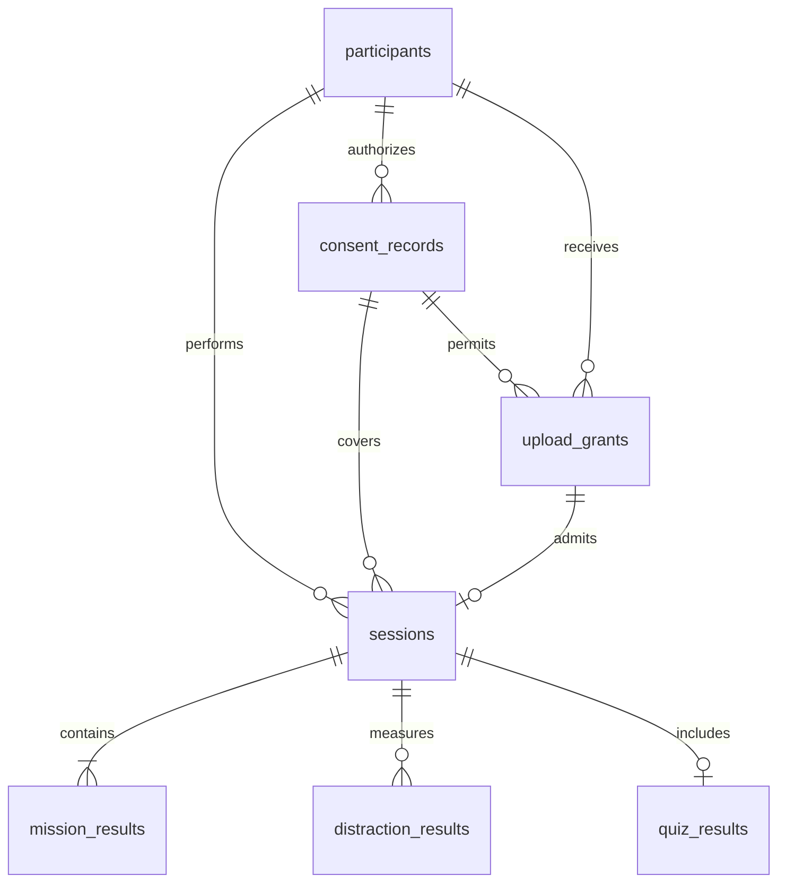

# Collection design

## Measurement inventory

| Source in Assets/HomeTasks/Scripts | Available observations |
| --- | --- |
| Core/HomeSession.cs | Scaled gameplay elapsed seconds, washed and stored dish counts, disposed bag counts, configured item totals and four completion flags |
| Core/HomeSessionResult.cs and UI/HomeResultsPanel.cs | Immutable completed-session snapshot and its formatted results. Values are taken before the scene transition. |
| Core/DistractionLedger.cs and Interaction scripts | Counts and seconds for nine named types, aggregated over the whole session. A zero in a present ledger row was measured. |
| Tasks/MeetingController.cs | Configured question count, current attempt's answer count and correct count. Leaving the seat clears an unfinished attempt. |

Task timers, focus duration and per-mission distraction attribution are unavailable. UTC timestamps and application version are collection metadata. The meeting quiz measures recall of that briefing. Gameplay observations alone do not establish a learning gain. A separate, optional, matched pre/post knowledge questionnaire could evaluate an explicitly defined learning objective.

## Implementation plan

1. Map gameplay events and nullable measurements to a versioned submission contract.
2. Store participant and consent records separately from immutable session results. Issue a single-session device credential only after staff confirm consent for that run.
3. Authenticate staff and restrict enrollment, exports, withdrawal and deletion to administrators.
4. Build bilingual views over the same stored measurements, including longitudinal views and filtered exports.
5. Persist consented Unity snapshots locally through interruptions. Retry a sealed result with a stable session ID.
6. Exercise migrations, repeat submissions, interrupted sessions, reports, privacy controls and offline delivery.

## Database relationships

An upload grant reserves a session UUID. The server stores a hash of its random bearer secret. The device setup groups several grants for the same participant. Unity consumes one when the player agrees to share a round, so a supervised device can start repeated rounds offline. One transaction inserts the session, its four mission rows, distraction rows and optional quiz row. A digest distinguishes an identical retry from a conflicting second payload. An independently numbered participant code remains stable across runs.
